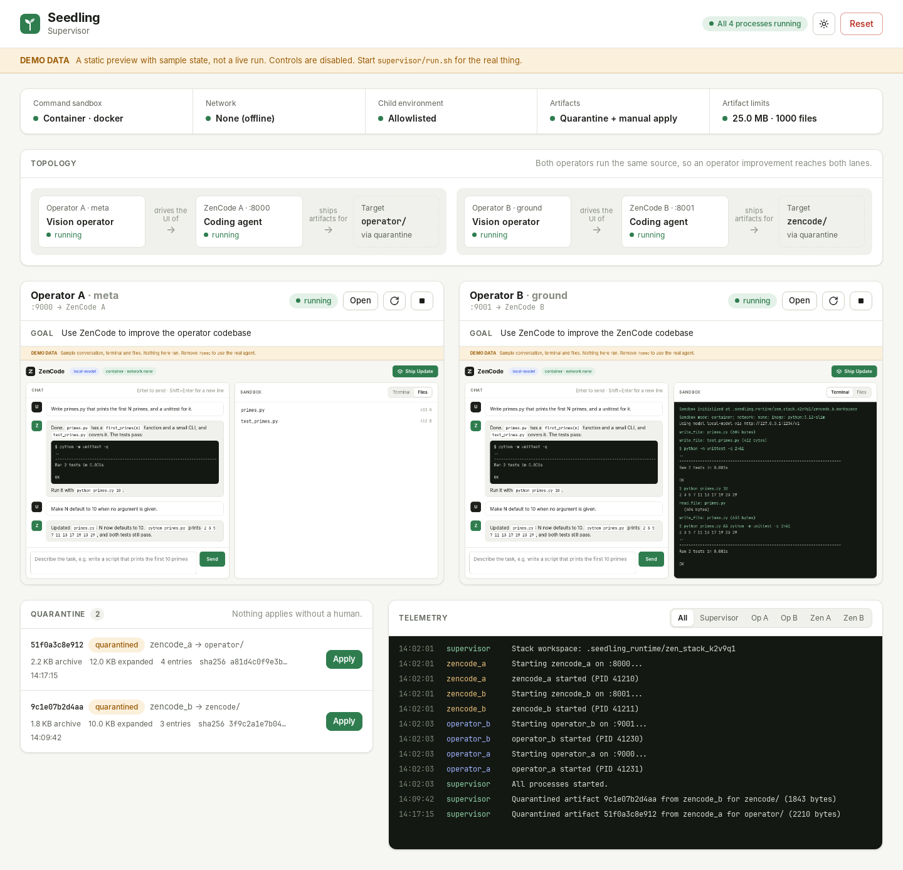
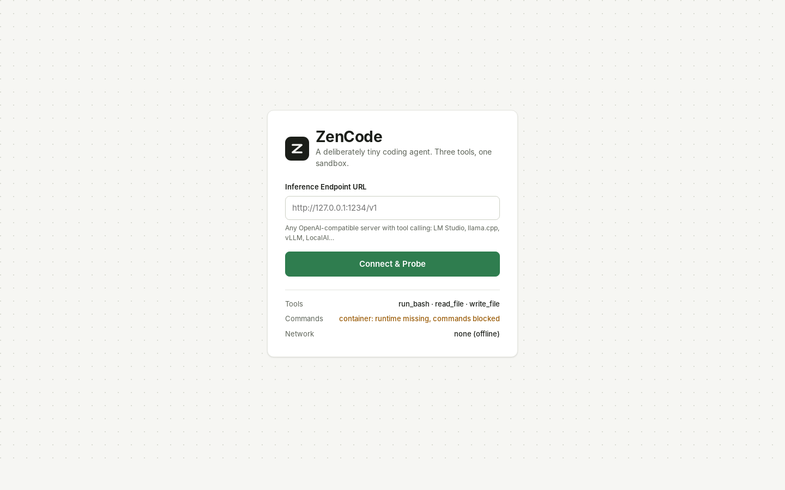
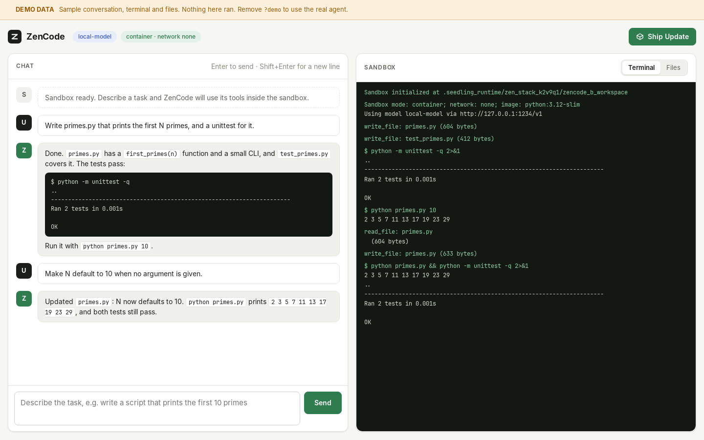
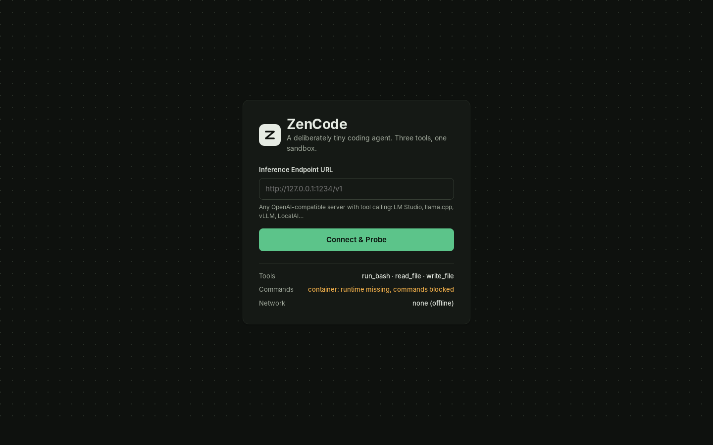
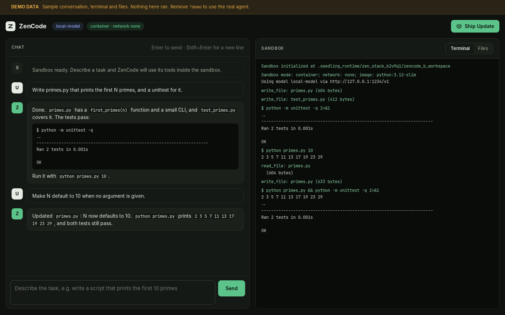
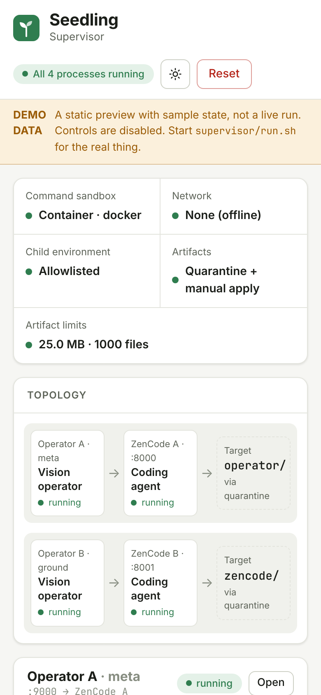
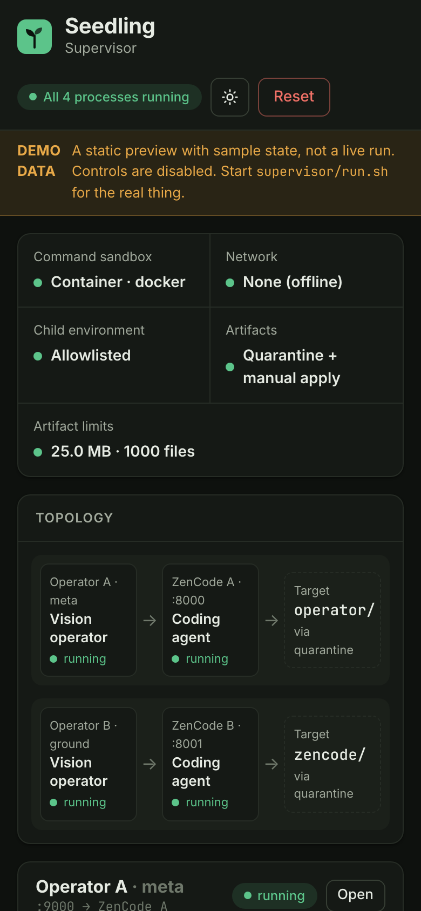
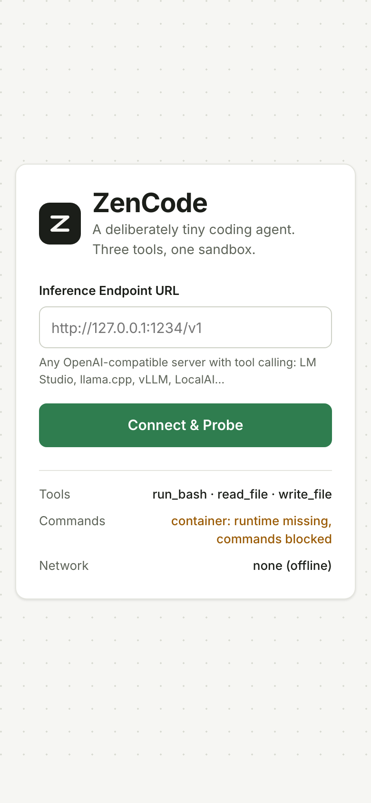

# Seedling

> The distance between zero and two dwarfs the distance between two and infinity.

Seedling is a small, local, supervised self-improvement loop: two coding agents, two vision-model operators, and a supervisor that won't let any of them touch anything they shouldn't. The only way in is through the UI.

<picture>
  <source media="(prefers-color-scheme: dark)" srcset="docs/screenshots/supervisor-demo-dark.png">
  
</picture>

<sub>The supervisor dashboard in demo mode (`?demo`): sample state, labelled as such in the UI. See [Status](#status) for what has and hasn't run for real.</sub>

## What it is

Four processes, one supervisor:

```
Supervisor (:7000)
├── Operator A (:9000) ──Playwright──→ ZenCode A (:8000)   goal: improve operator/
└── Operator B (:9001) ──Playwright──→ ZenCode B (:8001)   goal: improve zencode/
```

- **ZenCode** is a deliberately tiny coding agent. It talks to any OpenAI-compatible endpoint that supports tool calling and has exactly three tools: `run_bash`, `read_file` and `write_file`. When it has improved something, **Ship Update** packs its sandbox into a tarball in its outbox.
- **Operators** are vision-language-model agents. They never get a shell or an API into ZenCode. They see a screenshot, pick one action (`click`, `fill`, `wait`, `done`), and Playwright performs it. That is the whole interface.
- **The supervisor** (FastAPI and the dashboard above) starts and stops everything, watches the outboxes, quarantines each artifact, and applies it only when a human presses the button.

Operator A drives ZenCode A to improve the *operator* code. Operator B drives ZenCode B to improve *ZenCode*. Both operators run the same source, so when A ships an operator improvement, both operators get it on the next cycle.

## Why it's interesting

**Getting from zero to two is the hard part.** A system that can improve itself once, under supervision, is most of the way to one that can keep doing it. Seedling is an attempt at that first step, built so it can't cheat on the way.

- **The UI is the only interface.** Operators get pixels and clicks and nothing else. The agent being improved has to stay legible to something that can only look at it, so "works for a human-shaped user" is built into the loop instead of checked afterwards. That is also why ZenCode's UI uses big, plainly labelled controls.
- **A fixed point, not a recursion.** There are exactly two operators and no way to spawn a third. Improvements target source code, never the running instance. The loop converges on better operators instead of multiplying them.
- **Untrusted by default.** Everything that leaves a sandbox is treated as hostile until a human approves it:
  - shell commands run in one-shot Docker or Podman containers with no network, a read-only root, all capabilities dropped, and CPU, memory and PID caps. With no container runtime, commands are refused (it fails closed);
  - file tools reject absolute paths and any traversal outside the sandbox;
  - child processes get an allowlisted environment, not your shell's secrets;
  - update tarballs are checked for size, entry count, entry types and paths, hashed, and parked in quarantine. Nothing auto-applies.

## The interface

ZenCode is what the operators look at. The setup screen below is live; the workspace is ZenCode's demo mode, because a real session needs a local model.

| Setup (live) | Workspace (demo data) |
|---|---|
|  |  |
|  |  |

The live setup screen was captured on a machine with no container runtime, so it reports that commands are blocked. That is the fail-closed path working.

<p align="center">
  
  
  
</p>

## Run it

Requirements: Linux or macOS, Python 3.12+, Docker or Podman, free ports 7000, 8000, 8001, 9000 and 9001, and a local OpenAI-compatible server on `127.0.0.1:1234` (LM Studio's default) serving a vision-capable model for the operators. The operators open a visible Chromium window, so they need a desktop session.

```sh
git clone https://github.com/jon-vs-moloch/seedling.git
cd seedling
scripts/preflight.sh      # Python version, compile check, Docker/Podman (fails without one)
scripts/test.sh           # smoke tests in a throwaway venv; no model or container needed
cd supervisor
./run.sh                  # creates a venv, installs deps, serves on 127.0.0.1:7000
```

Open <http://127.0.0.1:7000>. On first start the supervisor creates the ZenCode and operator virtualenvs and installs Playwright's Chromium, so the first launch is slow. Then open ZenCode from the dashboard, point it at your inference endpoint and pick a model.

**Just want to look?** The dashboard and ZenCode both have a demo mode that needs nothing but Python:

```sh
python3 -m http.server --bind 127.0.0.1 --directory supervisor 7000
# then open http://127.0.0.1:7000/static/index.html?demo
python3 -m http.server --bind 127.0.0.1 --directory zencode/static 7001
# then open http://127.0.0.1:7001/index.html?demo
```

Optional settings (environment variables for `run.sh`):

| Variable | Default | What it does |
|---|---|---|
| `SEEDLING_SANDBOX_MODE` | `container` | `local` runs commands on the host. Development only; don't. |
| `SEEDLING_CONTAINER_RUNTIME` | auto (`docker`, then `podman`) | Path to the container runtime |
| `SEEDLING_SANDBOX_NETWORK` | `none` | Container network mode |
| `SEEDLING_SANDBOX_IMAGE` | `python:3.12-slim` | Image used for commands |
| `SEEDLING_SANDBOX_CPUS` / `_MEMORY` / `_PIDS` | `1` / `512m` / `128` | Resource caps |
| `SEEDLING_RUNTIME_DIR` | `.seedling_runtime/` | Where sandboxes live. Must be mountable by your container runtime. |

Every server binds to `127.0.0.1` and refuses requests whose `Host` is not `127.0.0.1`, `localhost` or `[::1]` on its port (DNS rebinding), and POSTs from any other web page (cross-site requests). There are no accounts or passwords, so other programs running as you can still call the APIs. The dashboard's **Reset** button stops everything, deletes the runtime sandboxes and quarantine, and starts fresh. While the stack runs, each process writes its output to `<runtime dir>/zen_stack_*/<name>.log`; the stack directory is removed on shutdown and reset.

### Desktop shell

`desktop/` holds a thin Tauri 2 shell: a splash screen, then the dashboard in a native window. `desktop/launch.sh` starts the supervisor and opens `desktop/src-tauri/target/release/seedling`. Building that binary needs Rust and the [Tauri prerequisites](https://v2.tauri.app/start/prerequisites/) (`cargo build --release` in `desktop/src-tauri`). This build has not been verified for this release.

## Status

**Experiment.** What is real and tested: the containment (container flags, path checks, environment allowlist), the archive checks, the quarantine, the manual apply path, the dashboard and ZenCode itself. A ZenCode instance shipping an artifact that lands in quarantine has been run end to end.

What has not been shown yet: a full cycle where an operator drives ZenCode to a useful improvement that is then applied. The vision-operator loop is observational; watch it, don't depend on it. Also:

- applying an artifact copies it over `zencode/` or `operator/` in place. There is no backup and no automatic rollback (use git);
- nothing tests an artifact before a human applies it;
- ZenCode B's sandbox starts empty, so a ZenCode improvement has to be rebuilt inside the sandbox. ZenCode A's starts with the operator's docs and its action parser ([`operator/README.md`](operator/README.md)), the one file it is asked to improve;
- ports are fixed.

[`docs/SAFETY.md`](docs/SAFETY.md) has the safety notes. [`design-doc-v0.md`](design-doc-v0.md) and [`design-doc-v1.md`](design-doc-v1.md) describe where it is headed.

## Layout

| Path | What it is |
|---|---|
| [`supervisor/`](supervisor) | Process manager, quarantine and dashboard (`static/`, demo data in `static/demo/`) |
| [`zencode/`](zencode) | The coding agent and its UI |
| [`operator/`](operator) | The vision operator and its control page |
| [`desktop/`](desktop) | Optional Tauri shell |
| [`scripts/`](scripts) | Preflight, smoke tests, the cycle driver (`run_cycle.py`) and the cycle measurement (`measure_cycle.py`) |
| [`tests/`](tests) | Smoke tests (`scripts/test.sh`) |

## License

[Apache-2.0](LICENSE) © 2026 Jonathan Meriwether
